<p align="center">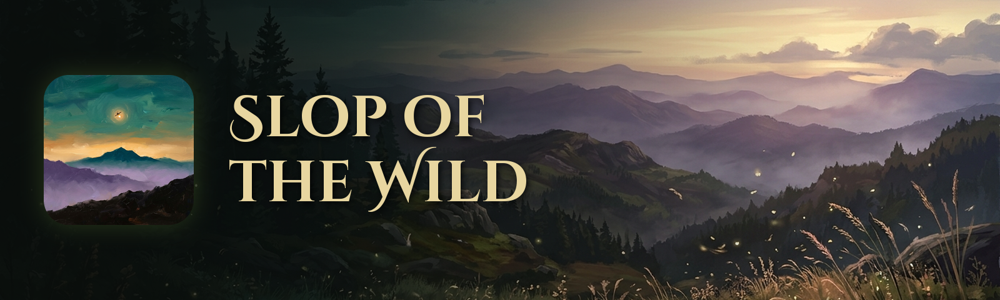</p>

**Slop of the Wild** is a native Windows version of *The Legend of Zelda: Breath of the Wild* (Switch version 1.9.0), with a lot of extra options for how it looks and plays. It's a fork of [Savage Wind Recomp](https://github.com/Revivedx/SavageWindRecomp), which does the hard part: turning the game's code into a PC program.

**[Download the newest release](../../releases)** · [Install it](#how-to-install) · [What's new and known issues](../../releases) · [Help test it](#help-test-it)

> [!CAUTION]
> **No game files are included, and none ever will be**: not in the code, the releases, the issues or the wiki. You need your own copy, dumped from your own Switch. Please don't post game files, dumps, keys or an installed copy here.

> [!IMPORTANT]
> **Made with AI.** Every line of code in this fork, every test and this page were written by Claude, Anthropic's AI, through Claude Code. A human, [devall96](https://github.com/devall96), directs it and plays every build, but no human reviews the code line by line. If you don't want to run code written that way, don't run this. As with anything on the internet, you run it at your own risk.

> [!WARNING]
> **Early, and tested on very few PCs.** Options marked **(beta)** in the menus haven't been tested thoroughly and may break things. Keep a copy of any saves you care about.

## Why this exists

I started this for myself. I wanted to play Breath of the Wild the way I'd always wanted to, and seeing how well the Tears of the Kingdom port turned out was what finally got me working on it. As it grew into something special, I put it on GitHub so anyone else who wants to play it this way can too.

## Screenshots

| | |
| --- | --- |
| 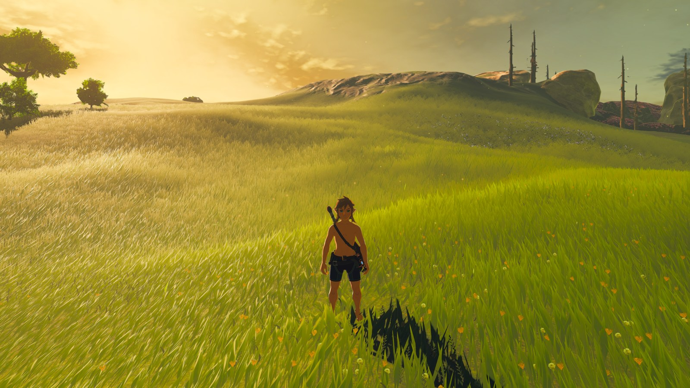 | 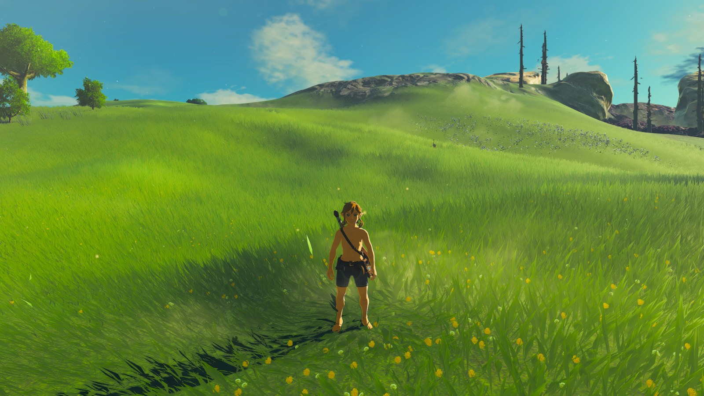 |
| 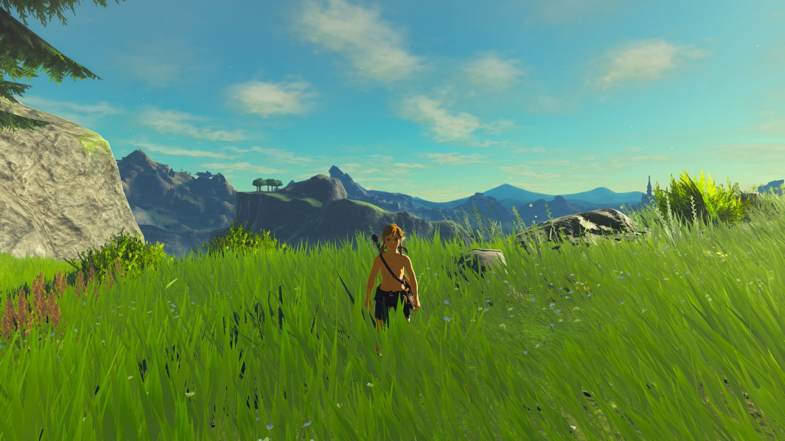 | 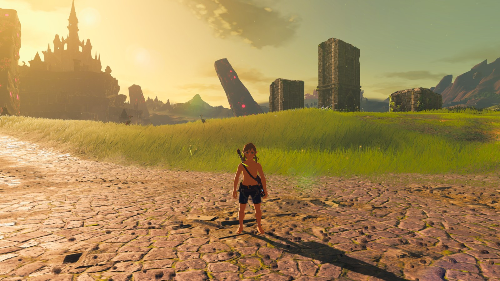 |
| 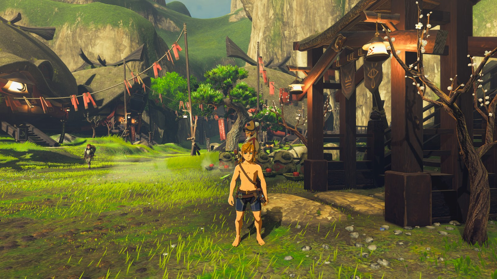 | 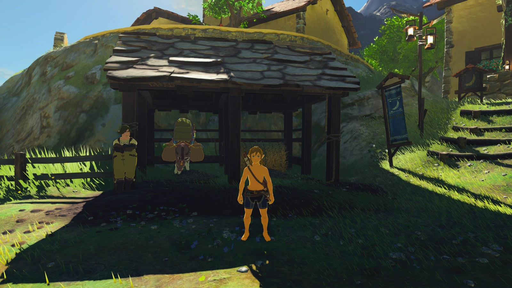 |
| 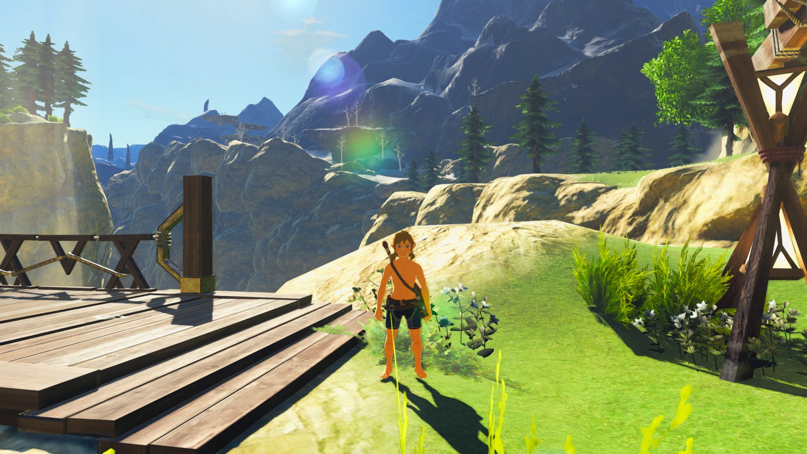 | 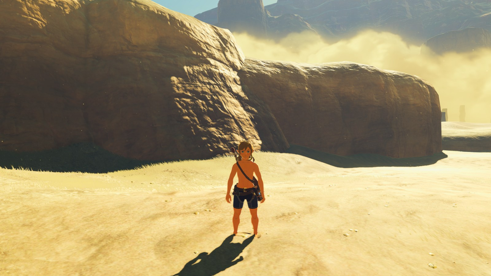 |

## What it adds

**Picture**
- Extended draw distance, with sliders for distance, grass and objects
- Graphics presets from Potato to High
- Clarity, a port of Cemu's BOTW graphics pack, plus colour grading with LUTs and HDR10
- TAA, SMAA and AMD FSR 4 anti-aliasing, FSR 1 upscaling, and render scale up to 200%: supersampling, so a 1080p screen can show a 4K image
- Sharper text and sharper menus for 1440p and 4K, upscaled on your own PC from your own game files
- Higher resolution shadows, field of view options, and wide screen support
- Fullscreen mode and monitor choice
- A fix for grass blowing out to white when it rains in sunshine

**Play**
- High frame rates, with an option that pulls the grass in when the game can't keep up
- Mouse and keyboard, a mouse pointer in the menus, mouse bow aiming, and full rebinding
- Controller support with Xbox, PlayStation and Nintendo prompts, gyro aiming, and a choice of Confirm button, and camera speeds faster than the game's fastest
- A cheats page: health, stamina, arrows, weapons, damage, rupees and weather
- Photo mode with filters
- Teleport bookmarks
- Achievements, with a notice as they unlock
- Start at Continue: straight into your latest save

**Around the game**
- A real installer and uninstaller
- A built-in updater: it checks for new releases, downloads the installer, verifies it, and starts it
- A settings menu from the controller's Home button, and a performance overlay with a frame-time graph
- Shaders prepared ahead of time, so there's very little shader stutter, with a notice when they're out of date
- Fast re-setup: compiled game code is kept, so a small update takes seconds, not minutes
- A built-in benchmark and a recommended preset
- Settings profiles and save backups
- Wii U and Cemu save import
- A mods folder and language packs
- A one-button problem report
- The DLC, if you own it

The exact state of each is in the [release notes](../../releases).

## How to install

**You need:**
- Windows 10 or newer, 64-bit
- A graphics card with a Vulkan 1.3 driver
- About 16 GB of free disk space
- Your own copy of the game: version 1.9.0 with the update merged, dumped from your own Switch. Other versions, like 1.6.0, won't work: update the game on your Switch first, then dump it. The DLC is optional, dumped the same way.

**1. Download the installer.** Get `SlopOfTheWild-<version>-Setup.exe` from the newest entry on the [Releases page](../../releases). It holds only the program and its tools, no game files.

**2. Run it.** Windows may warn you, because the installer isn't signed.

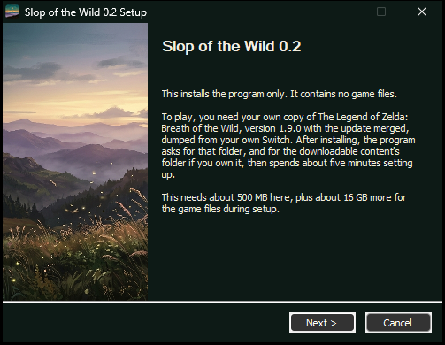

**3. Choose a folder.** Pick one you can write to, not Program Files. Saves, settings and game files are kept next to the program.

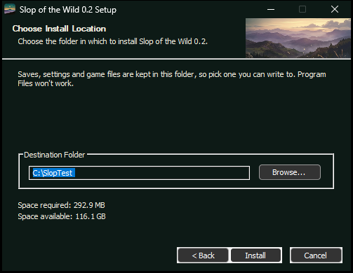

**4. Finish, and start it.** Leave **Start Slop of the Wild** ticked.

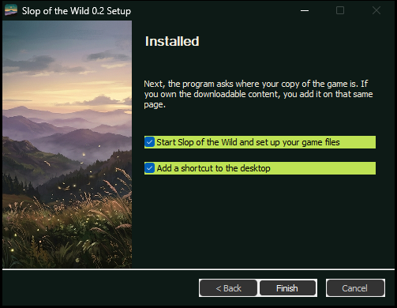

**5. Point it at your game.** Under **Game Files**, choose the folder that holds your dump: `exefs` and `romfs` folders, a few folders down at most. `.nsp` and `.xci` files won't work, so extract them first. If you own the DLC, add its folder too: the start screen then says **DLC: 1 + 2 (3.0)**, and you can add it later the same way. Then press **Set up game files**.

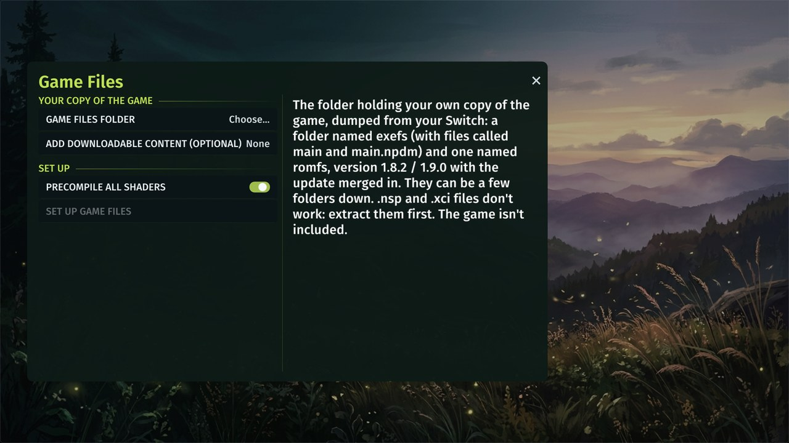

**6. Wait for setup.** It builds the game code on your PC and prepares the shaders, about five minutes on a desktop. It only needs doing once per version.

**7. Play.** From then on, starting the game goes straight to the title screen.

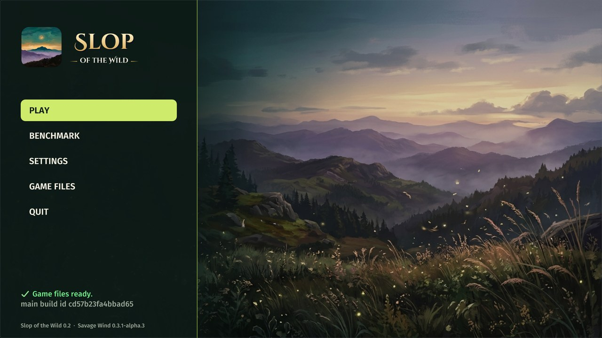

Settings are in the game's own Options menu, and in `Slop of the Wild Configuration.exe`.

**Updating:** use **Settings > Prelaunch > Check for updates**, or download the newest installer and install over your old folder. Saves and settings stay, and setup runs again if the game code changed, so keep your dump handy.

## Help test it

Almost all testing so far has been on one PC, so **reports from other hardware are the most useful thing you can send.** That goes for AMD, NVIDIA and Intel, laptops, older cards, and PCs with little memory. Good news helps too: "it runs fine on this card" tells me what works.

To report, [open an issue](../../issues) with:
- Your graphics card, CPU and memory
- What you did and what happened, with a screenshot if you can
- The folder from **Make a problem report**, or `savagewind.log` from the install folder

The built-in benchmark is an easy way to send comparable numbers.

**Never attach game files, dumps, keys or saves.**

## Build it yourself

On Windows, with [MSYS2](https://www.msys2.org) at `C:\msys64`, in the **UCRT64** shell ([more detail](docs/BUILD-windows.md)):

```sh
pacman -Syuu    # twice, as MSYS2 asks
pacman -S --needed git make mingw-w64-ucrt-x86_64-clang mingw-w64-ucrt-x86_64-lld mingw-w64-ucrt-x86_64-sdl3 \
  mingw-w64-ucrt-x86_64-ffmpeg mingw-w64-ucrt-x86_64-vulkan-headers mingw-w64-ucrt-x86_64-vulkan-loader \
  mingw-w64-ucrt-x86_64-shaderc mingw-w64-ucrt-x86_64-spirv-tools mingw-w64-ucrt-x86_64-pkgconf \
  mingw-w64-ucrt-x86_64-vulkan-memory-allocator mingw-w64-ucrt-x86_64-nasm mingw-w64-ucrt-x86_64-nsis
git -c core.autocrlf=false clone https://github.com/devall96/Slop-of-the-Wild slop && cd slop
make deps-windows             # FFmpeg, LGPL build
tools/fetch_zig.sh            # the compiler that setup bundles
make gen-helper GEN_PY=python # the game code generator (needs Python 3.12)
make -j dist GEN_PY=python    # build/dist/Slop of the Wild
make installer                # build/dist/SlopOfTheWild-<version>-Setup.exe
```

## Who did what

**devall96, the human:** the project and its goals, playing every build, spotting what the numbers miss, and deciding what stays.

**Claude:** the code, the tests, the measurements and this page.

**Savage Wind and its contributors:** nearly everything underneath. If you want something tested by more people, or on Linux or Steam Deck, [Savage Wind](https://github.com/Revivedx/SavageWindRecomp) is the place to look.

## Credits

- **[Savage Wind Recomp](https://github.com/Revivedx/SavageWindRecomp)** by Revivedx and contributors, and **[LAS Recomp](https://github.com/peiikai/LASRecomp)** by Peiikai, which it builds on. MIT License (see [LICENSE](LICENSE)).
- **Clarity** from the [Cemu graphic packs](https://github.com/cemu-project/cemu_graphic_packs) (CC0): Jamie, Kiri and Crementif; presets by Serfrost.
- **[The Legend of Zelda decompilation project](https://github.com/zeldaret/botw)**, whose names helped find things in the game.
- **[TotK PC recomp](https://github.com/valentderah/totk-pc-recomp)** by valentderah: the bar this aims for.
- The title's lettering is [Cinzel Decorative](https://github.com/google/fonts/tree/main/ofl/cinzeldecorative) by Natanael Gama (OFL). The launcher art and icon were made with Gemini.
- *The Legend of Zelda: Breath of the Wild* is Nintendo's. This project is not affiliated with or endorsed by Nintendo.
